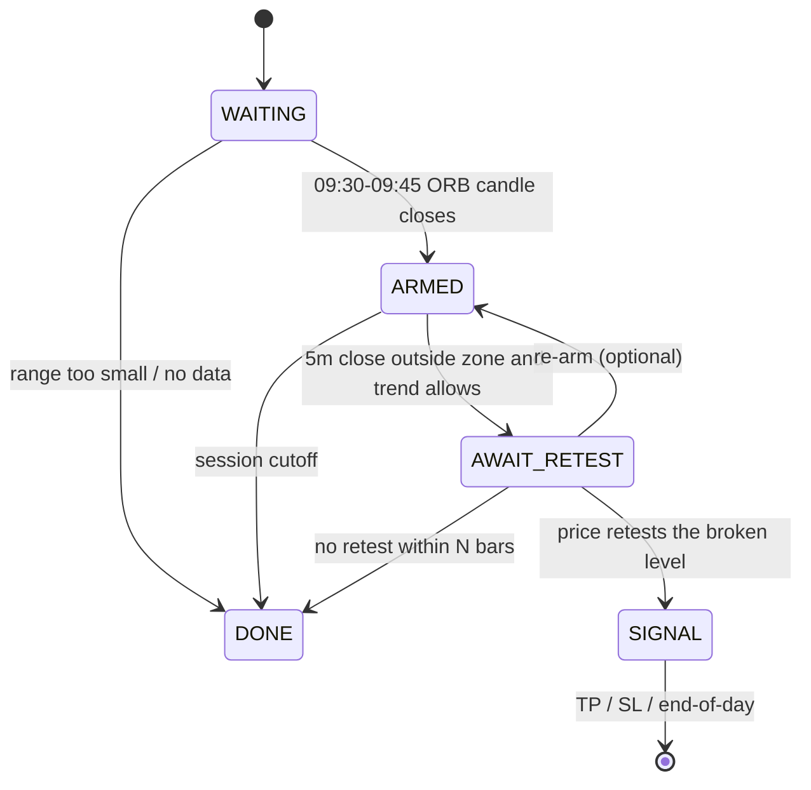
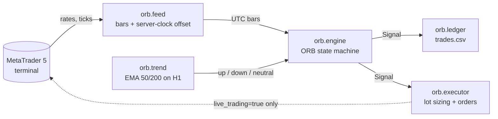
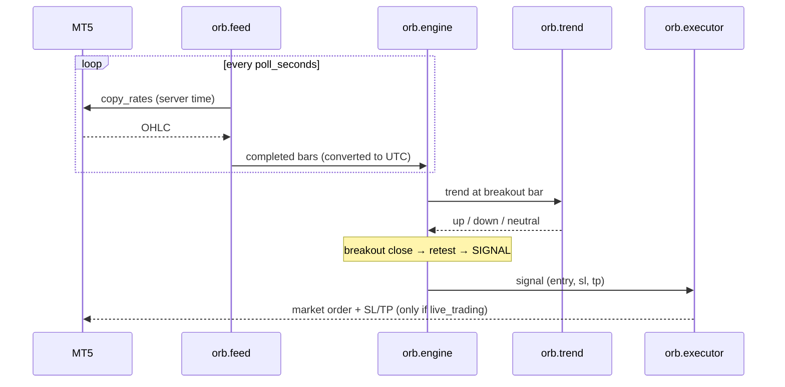

# ORB US100 — Opening Range Breakout Bot (MetaTrader 5)

A signal-only-first trading bot that implements the **Opening Range Breakout (ORB)**
strategy on **Nasdaq (US100)** through MetaTrader 5, plus a backtester and a small,
fully-tested strategy engine.

The rule set comes from a trader's description:

> "First 15 minutes candle from US stock market open, after the first 15m candle is
> formed you mark the area, zoom into 5 min tf, wait for a breakout and close outside
> the 15 minute area, then enter on the retest, following the overall trend of the
> higher timeframe market."

Written in Python, MT5-connected, signal-only by default.

---

## The strategy

| Step | Rule |
|------|------|
| 1 | At **09:30 ET** take the **first 15-minute candle** → mark its high/low as the *opening range* (ORB zone). |
| 2 | Drop to the **5-minute** chart. |
| 3 | Wait for a **5m candle to close outside** the zone (above high = long, below low = short). |
| 4 | Wait for price to **retest** the broken boundary. |
| 5 | **Enter** in the breakout direction (market at the retest candle's close). Stop beyond the retest swing; target = **2R**. |
| 6 | Only take trades aligned with the **higher-timeframe trend** (1H EMA 50/200). |
| 7 | One signal per day; exit at TP, SL, or session cutoff (16:00 ET). |

---

## How the engine works

The core (`orb/engine.py`) is a pure, dependency-free state machine — no MT5, fully
unit-tested.



Key decision points:

- **Breakout confirmation** is a **5-minute close** beyond the boundary (not a wick).
- **Trend filter** is evaluated at the breakout bar: `up` → longs only, `down` → shorts
  only, `neutral` → both. Trend = `EMA50 > EMA200` on completed 1H bars.
- **Retest** = a later 5m candle whose range reaches the broken boundary.
- **Guards**: one signal/day, re-test timeout (`retest_timeout_bars`), a minimum stop
  distance floor (`min_risk_points`), and a session cutoff for new setups.

---

## Architecture



A trading day, end to end:



Session timeline (America/New_York):

```mermaid
gantt
    title US100 ORB session
    dateFormat HH:mm
    axisFormat %H:%M
    section Opening range
    First 15m candle - mark zone :09:30, 15m
    section Watch for setup
    5m breakout + retest scan :09:45, 375m
    section Exits
    Session cutoff - close open trades :16:00, 5m
```



---

## Quickstart

```bash
# 1. Requirements: Windows + MetaTrader 5 terminal running & logged in
pip install MetaTrader5

# 2. Run the signal-only bot (writes trades.csv, logs to bot.log)
python main.py

# 3. Backtest against real MT5 history
python backtest.py --days 150

# 4. Tests
python -m unittest discover -s tests
```

The bot connects to the running terminal, auto-detects the broker's server-clock
offset (FBS = UTC+3), and aligns everything to `America/New_York` so the ORB candle is
always the 09:30 ET open — DST-safe.

> On startup the bot **replays the current session** to stay restart-safe, but replayed
> signals are **never executed** — only bars that complete while it is running can
> trigger an order.

---

## Configuration (`config.json`)

| Key | Default | Meaning |
|-----|---------|---------|
| `symbol` | `US100` | Broker's Nasdaq CFD symbol |
| `live_trading` | `false` | `false` = signal/dry-run only |
| `poll_seconds` | `10` | Loop interval |
| `timezone` | `America/New_York` | Market session timezone |
| `session_open_local` | `09:30` | Opening range start |
| `session_cutoff_local` | `16:00` | No new setups after this |
| `orb_timeframe_minutes` | `15` | Opening range timeframe |
| `entry_timeframe_minutes` | `5` | Breakout/retest timeframe |
| `min_zone_range` | `5.0` | Skip days with a tiny opening range |
| `entry_mode` | `retest_close` | `retest_close` (market) or `limit` (at boundary) |
| `sl_mode` | `retest_swing` | `retest_swing` (tight) or `zone_opposite` |
| `sl_buffer` | `1.0` | Extra cushion beyond the stop reference |
| `min_risk_points` | `20.0` | Minimum stop distance floor |
| `tp_r` | `2.0` | Take-profit as a multiple of risk |
| `exit_at_cutoff` | `true` | Close open trades at the cutoff |
| `retest_buffer` | `0.0` | Proximity tolerance for a retest |
| `retest_timeout_bars` | `12` | Cancel if no retest within N 5m bars |
| `allow_rearm` | `false` | Re-arm after a retest timeout |
| `max_signals_per_day` | `1` | Daily signal cap |
| `trend.*` | EMA 50/200 on H1 | Higher-timeframe filter |
| `execution.lot_mode` | `risk_percent` | `risk_percent` or `fixed` |
| `execution.risk_percent` | `1.0` | % of equity risked per trade |
| `execution.fixed_lot` | `0.01` | Lot size when `lot_mode = fixed` |
| `execution.magic` | `20261014` | Order tag to identify bot positions |

---

## Backtest results (150 days, US100, 4-pt round-trip cost)

```
signals            : 64  (TP 39 / SL 24 / EOD 1)
win rate           : 62.5%
net avg per signal : +0.69R
net total          : +44.1R
signals per day    : 0.49
```

`retest_close` (market entry) beats `limit` (entry at the boundary):

| entry_mode | win rate | net avg | net total |
|------------|----------|---------|-----------|
| `limit` | 51.6% | +0.40R | +25.9R |
| **`retest_close`** | **62.5%** | **+0.69R** | **+44.1R** |

### Honest caveats

- **Stop placement dominates the edge.** The wide `zone_opposite` stop is negative on
  this sample; `retest_swing` with a `min_risk_points` floor is the profitable version.
- **Sub-spread stops inflate results.** Raw retest swings can be ~1 point wide; the
  `min_risk_points = 20` floor exists to keep stops realistic. The edge is *sensitive* —
  a 40-point floor turns negative.
- **The 1H EMA trend filter added no measurable edge** on this sample (kept per the
  strategy description; set `trend.enabled: false` to compare).
- Small sample, demo data, flat cost model. **Forward-test before risking capital.**

---

## Project structure

```
ORB/
├── main.py            # live signal/dry-run loop + catch-up guard
├── backtest.py        # replay engine over MT5 history
├── config.json        # all parameters
├── orb/
│   ├── engine.py      # pure ORB state machine (unit-tested)
│   ├── feed.py        # MT5 adapter + server-offset handling
│   ├── trend.py       # EMA + H1 trend provider
│   ├── executor.py    # lot sizing + order placement
│   ├── ledger.py      # trades.csv writer
│   └── models.py      # Bar / Zone / Signal / Direction
└── tests/             # 33 unit tests
```

---

## Safety

- **Signal-only by default.** Orders are placed only with `live_trading: true` or
  `python main.py --live`.
- **One position at a time**, tagged with `execution.magic`.
- **Risk-based sizing** from live equity; skipped (not silently increased) if the
  budget cannot fund the minimum lot.
- Not financial advice. Test on a demo account first.
