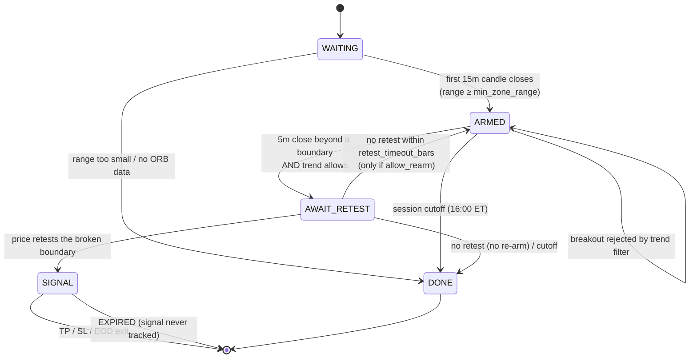
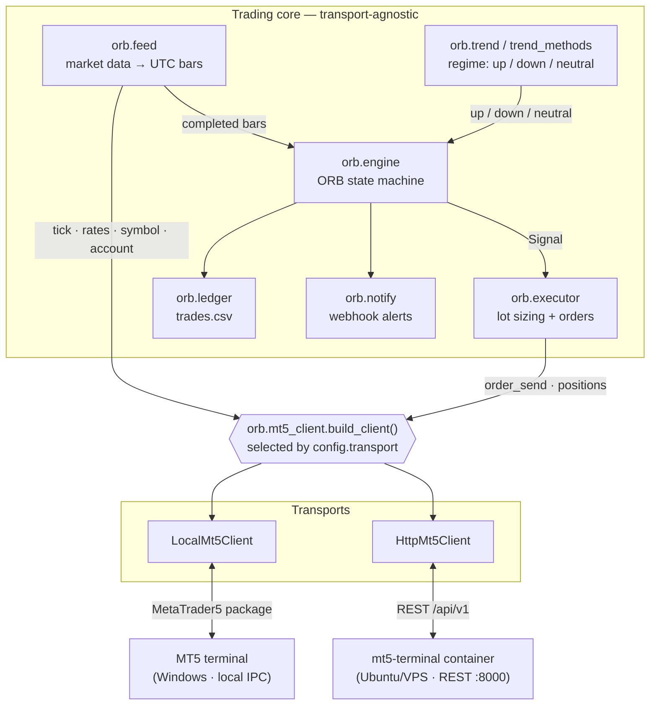
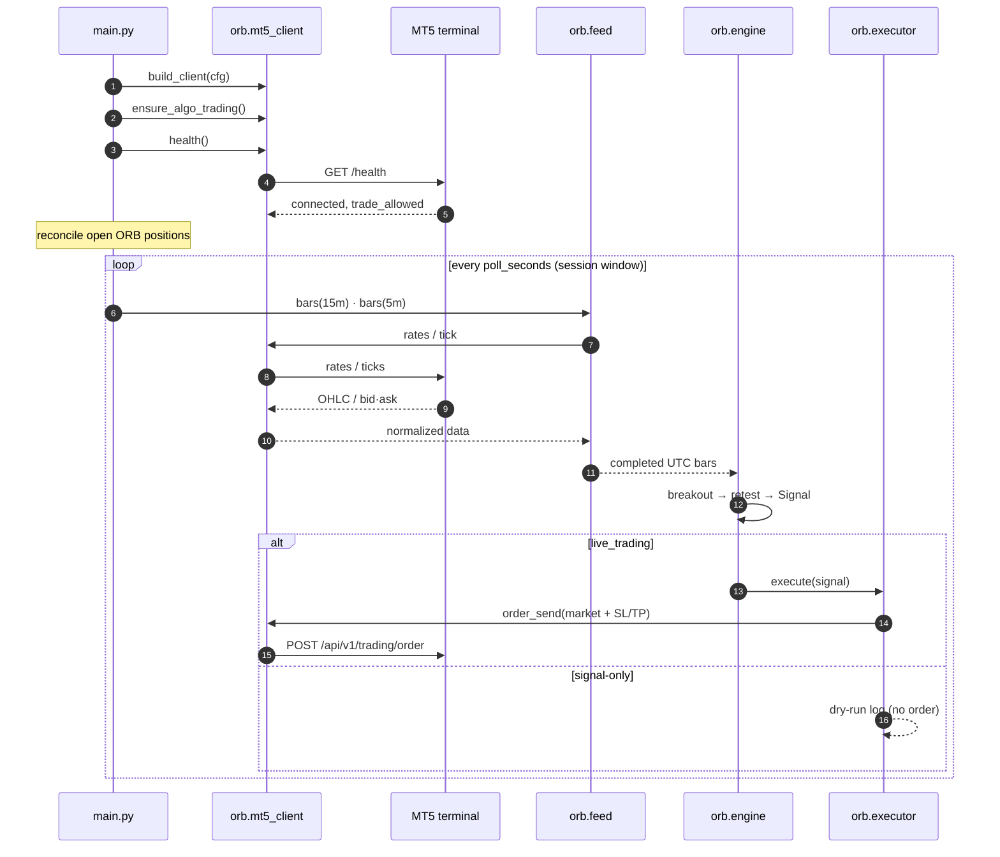
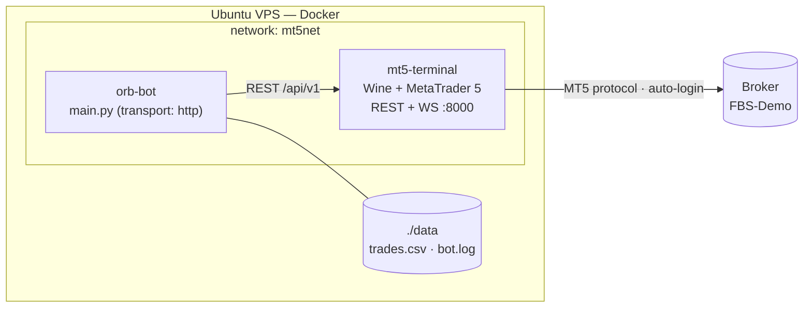

# ORB US100 Bot (MetaTrader 5)

A **signal-only-first** trading bot that implements the **ORB** strategy on
**Nasdaq (US100)** through MetaTrader 5, packaged with a
backtester, a parameter-robustness lab and a small, fully-tested strategy engine.

The rule set comes from a trader's description:

> "First 15 minutes candle from US stock market open, after the first 15m candle is
> formed you mark the area, zoom into 5 min tf, wait for a breakout and close outside
> the 15 minute area, then enter on the retest, following the overall trend of the
> higher timeframe market."

Written in Python. It runs in two interchangeable ways:

- **Local** — the `MetaTrader5` Python package talking to a terminal on the same
  Windows machine (default; used for development and offline backtests).
- **HTTP** — a plain REST client talking to a **dockerized MT5 terminal** on an
  Ubuntu VPS, so the bot can run 24/7 without a PC.

The engine is transport-agnostic: the same strategy, backtests and tools work over
either transport. Orders are never sent unless `live_trading` is enabled.

## Contents

- [The strategy](#the-strategy)
- [How the engine works](#how-the-engine-works)
- [Architecture](#architecture)
- [Quickstart](#quickstart)
- [Configuration](#configuration-configjson)
- [Deployment (Ubuntu VPS + Docker)](#deployment-ubuntu-vps--docker)
- [Backtest results](#backtest-results-150-days-us100-4-pt-round-trip-cost)
- [Project structure](#project-structure)
- [Safety](#safety)

---

## The strategy

| Step | Rule |
|------|------|
| 1 | At **09:30 ET** take the **first 15-minute candle** → mark its high/low as the *opening range* (ORB zone). |
| 2 | Drop to the **5-minute** chart. |
| 3 | Wait for a **5m candle to close outside** the zone (above high = long, below low = short). |
| 4 | Wait for price to **retest** the broken boundary. |
| 5 | **Enter** in the breakout direction (market at the retest candle's close). Stop beyond the retest swing; target = **2R**. |
| 6 | *Optional* higher-timeframe trend filter (1H EMA 50/200) — **off by default** (see [Trend-filter findings](#trend-filter-findings)). |
| 7 | One signal per day; exit at TP, SL, or session cutoff (16:00 ET). |

---

## How the engine works

The core (`orb/engine.py`) is a pure, dependency-free state machine — **no MT5, fully
unit-tested**. One instance drives one trading day; bars are fed in as completed UTC
candles.



Key decision points:

- **Breakout confirmation** is a **5-minute close** beyond the boundary (never a wick).
- **Trend filter** is evaluated *at the breakout bar*: `up` → longs only, `down` →
  shorts only, `neutral` → both. It is **off by default** (see findings).
- **Retest** = a later 5m candle whose range reaches the broken boundary; the fill is
  the boundary (or the approached price within `retest_buffer`, never optimistic).
- **Stop** = the retest swing (or the opposite zone side), widened to at least
  `min_risk_points` so sub-spread stops cannot inflate the backtest.
- **Guards**: one signal/day (`max_signals_per_day`), a retest timeout
  (`retest_timeout_bars`), and a session cutoff that blocks new setups.

---

## Architecture

The strategy never touches MT5 directly. Everything is expressed against a thin
**client** whose implementation is chosen by `config.transport`.



**Transports** (`orb.mt5_client`):

| `transport` | Client | Endpoint | Use |
|-------------|--------|----------|-----|
| `local` *(default)* | `LocalMt5Client` | `MetaTrader5` package IPC | Windows / development |
| `http` | `HttpMt5Client` | REST to a dockerized terminal | Ubuntu VPS, 24/7 |

Override per run with `--transport http`.

**A live session, end to end** (startup gate → poll loop → order):



**Session timeline** (America/New_York):


---

## Quickstart

```bash
# 1. Requirements: Windows + MetaTrader 5 terminal running & logged in
pip install -r requirements-local.txt   # core + MetaTrader5 (local IPC)

# 2. Validate the order pipeline without sending an order
python main.py --selftest

# 3. Run the signal-only bot (writes trades.csv, logs to bot.log)
python main.py

# 4. Backtest against real MT5 history (+ stability across 4 chunks)
python backtest.py --days 150 --windows 4

# 5. Parameter robustness sweep
python sweep.py --days 150

# 6. Trend-filter lab (compares filter variants, no orders/writes)
python trendlab.py --days 150 --symbols US500,US30

# 7. Robust walk-forward parameter selection
python select.py --days 150 --folds 4 --symbol US100 --symbols US30

# 8. Forward-test parity: live trades.csv vs a backtest of the same period
python forward.py

# 9. Tests
python -m unittest discover -s tests
```

The bot connects to the terminal, auto-detects the broker's server-clock offset
(FBS = UTC+3), and aligns everything to `America/New_York` so the ORB candle is
always the 09:30 ET open — DST-safe.

> On startup the bot **replays the current session** to stay restart-safe, but replayed
> signals are **never executed** — only bars that complete while it is running can
> trigger an order.

Running against a remote terminal instead of a local one:

```bash
pip install -r requirements.txt          # core only (no MetaTrader5 package)
export ORB_API_KEY=...                    # or ORB_API_SEED=...
python main.py --transport http --selftest
python main.py --transport http
```

---

## Configuration (`config.json`)

### Transport & symbol

| Key | Default | Meaning |
|-----|---------|---------|
| `symbol` | `US100` | Broker's Nasdaq CFD symbol |
| `transport` | `local` | `local` (MT5 IPC) or `http` (terminal REST API) |
| `api.base_url` | `http://mt5-terminal:8000` | Terminal API base URL (HTTP transport) |
| `api.key_env` / `api.seed_env` | `ORB_API_KEY` / `ORB_API_SEED` | Env vars holding the API key or login seed |
| `api.timeout_sec` | `10` | HTTP request timeout |

### Strategy & session

| Key | Default | Meaning |
|-----|---------|---------|
| `live_trading` | `false` | `false` = signal/dry-run only |
| `poll_seconds` | `10` | Loop interval |
| `timezone` | `America/New_York` | Market session timezone |
| `session_open_local` | `09:30` | Opening range start |
| `session_cutoff_local` | `16:00` | No new setups after this |
| `orb_timeframe_minutes` | `15` | Opening range timeframe |
| `entry_timeframe_minutes` | `5` | Breakout/retest timeframe |
| `min_zone_range` | `5.0` | Skip days with a tiny opening range |
| `entry_mode` | `retest_close` | `retest_close` (market) or `limit` (at boundary) |
| `sl_mode` | `retest_swing` | `retest_swing` (tight) or `zone_opposite` |
| `sl_buffer` | `1.0` | Extra cushion beyond the stop reference |
| `min_risk_points` | `20.0` | Minimum stop distance floor |
| `tp_r` | `2.0` | Take-profit as a multiple of risk |
| `exit_at_cutoff` | `true` | Close open trades at the cutoff |
| `retest_buffer` | `0.0` | Proximity tolerance for a retest |
| `retest_timeout_bars` | `12` | Cancel if no retest within N 5m bars |
| `allow_rearm` | `false` | Re-arm after a retest timeout |
| `max_signals_per_day` | `1` | Daily signal cap |

### Filters, costs, risk & execution

| Key | Default | Meaning |
|-----|---------|---------|
| `trend.enabled` | `false` | Higher-timeframe trend filter (off by default — see findings) |
| `trend.method` | `ema_cross` | `ema_cross`, `price_ema200`, `ema_slope200`, `ema_slope50`, `adx_gate`, `prior_day` |
| `costs.spread_points` | `4.0` | Round-trip cost in index points (spread + slippage) |
| `costs.commission_per_lot` | `0.0` | Round-trip commission per lot (converted to points) |
| `risk.max_daily_loss_r` | `2.0` | Stop taking signals after this much realized loss in a day (`0` = off) |
| `alerts.enabled` / `alerts.webhook_url` | `false` / `""` | Optional webhook alerts (Discord/Slack JSON). Prefer `ORB_WEBHOOK_URL` env var |
| `execution.lot_mode` | `fixed` | `fixed` or `risk_percent` (demo equity is too small for `risk_percent`) |
| `execution.risk_percent` | `1.0` | % of equity risked per trade (when `lot_mode = risk_percent`) |
| `execution.fixed_lot` | `0.01` | Lot size when `lot_mode = fixed` |
| `execution.magic` | `20261014` | Order tag to identify bot positions |

> **Demo note:** with $85 equity, 1% risk over a ~20pt stop sizes to 0.004 lot — below
> the 0.01 minimum — so `risk_percent` mode skips every trade. The demo therefore
> defaults to `lot_mode: fixed`, `fixed_lot: 0.01` (~2.3% of this balance per trade).

Environment variables (all optional): `ORB_CONFIG` (config path), `ORB_DATA_DIR`
(where `trades.csv` and `bot.log` live), `ORB_WEBHOOK_URL`, plus the API vars above.

---

## Deployment (Ubuntu VPS + Docker)

Run the bot 24/7 **on the same VPS** as a dockerized MT5 terminal, so it no longer
depends on a local PC. The reference terminal image is
[`nodalytics/metatrader-terminal`](https://github.com/nodalytics/metatrader-terminal)
(Wine-based MT5 exposing a **REST + WebSocket API**). The bot then uses
`transport: "http"` and never imports the `MetaTrader5` package.



### 1. Terminal container

Deploy the terminal image on the VPS (its own compose), logged into your broker and
with AutoTrading enabled. Note its **service name / port** — the bot reaches it at
`http://<service>:8000` on a shared Docker network.

### 2. Bot container

```bash
cp .env.example .env     # fill in ORB_API_KEY (or ORB_API_SEED) and MT5_NETWORK
# set "transport": "http" in config.json (or pass --transport http)
docker compose up -d --build
```

`docker-compose.yml` joins the terminal's network (`MT5_NETWORK`, default `mt5net`),
mounts `./data` for `trades.csv` + `bot.log`, mounts `config.json` read-only, and
restarts `unless-stopped`.

### 3. Verify before going live

```bash
# startup health gate + order_check through the API
docker compose run --rm orb-bot python main.py --selftest

# watch the signal-only loop
docker compose logs -f orb-bot
```

On startup the bot logs `terminal health | connected=... trade_allowed=...`, enables
algo trading, and reconciles any position left open from a previous run.

### Endpoints used

| Bot call | Terminal endpoint |
|----------|-------------------|
| auth | `POST /api/v1/auth/login` |
| symbol info | `GET /api/v1/symbols/{symbol}` |
| account info | `GET /api/v1/terminal/account/info` |
| health | `GET /health`, `GET /api/v1/terminal/info` |
| enable AutoTrading | `POST /api/v1/terminal/algo-trading` |
| tick | `GET /api/v1/symbols/ticks/{symbol}` |
| bars (recent) | `GET /api/v1/symbols/rates/pos` |
| bars (history / backtest) | `GET /api/v1/symbols/rates/range` |
| open positions | `GET /api/v1/positions/by_symbol/{symbol}` |
| order check | `GET /api/v1/trading/order_check/{symbol}` |
| place order | `POST /api/v1/trading/order` |
| modify SL/TP | `POST /api/v1/positions/modify` |

> **API schema note.** The REST client parses responses tolerantly (several field
> aliases) because exact param names are confirmed from the terminal's `/docs`. If your
> deployment differs, adjust the mapping in `orb/mt5_client.py` (`HttpMt5Client`).

---

## Backtest results (150 days, US100, 4-pt round-trip cost)

Default config (`retest_close`, `retest_swing`, TP 2R, `min_risk_points` 20, trend **off**):

```
signals            : 105  (TP 61 / SL 42 / EOD 2)
gross              : 58.1% WR  |  +0.76R avg  |  +79.5R total
net (cost 4.0 pt)  : 58.1% WR  |  +0.59R avg  |  +62.4R total
signals per day    : 0.70
```

Split into 4 equal chunks, the edge holds in every chunk (net `+10.6R` / `+23.7R` /
`+14.9R` / `+13.2R`) — i.e. it is not driven by one lucky period.

`retest_close` (market entry) beats `limit` (entry at the boundary):

| entry_mode | win rate | net avg | net total |
|------------|----------|---------|-----------|
| `limit` | ~51% | +0.40R | +25.9R |
| **`retest_close`** | **~58%** | **+0.59R** | **+62.4R** |

### Trend-filter findings

The strategy description calls for trading in the direction of the higher-timeframe
trend. Tested rigorously (`trendlab.py`), that filter — in every variant — **does not
add edge**:

- On US100 the filter removes ~net-neutral trades: kept expectancy +0.607R vs removed
  +0.586R — a difference whose bootstrap 95% CI spans zero. It also lowers net return
  (+46.1R with `ema_cross` vs **+62.4R** with the filter off) at essentially the same
  drawdown. No variant (`price_ema200`, `ema_slope200/50`, `adx_gate`, `prior_day`)
  beats "off" on net R.
- The same holds on **US30** (every filter reduces net R).
- The direction buckets that look good (e.g. shorts in a "down" regime) do not persist
  across sample halves — they are noise, not regime signal.
- **The strategy is instrument-specific.** It is strongly positive on US100 (+62.4R) and
  US30 (+45.4R) but **negative on US500** (−24.7R) over the same period, and no filter
  rescues US500.

Conclusion: the edge lives in the ORB breakout/retest mechanics and stop placement, not
in the higher-timeframe trend. The filter is therefore **off by default**, but the
machinery is kept and selectable (`trend.enabled`, `trend.method`) for research.

### Selecting parameters (robust walk-forward)

`select.py` replays a small, principled grid over `N` independent time folds and ranks
candidates by **worst-fold net R** (robustness first), then net R:

```bash
python select.py --days 150 --folds 4 --symbol US100 --symbols US30
```

On US100 the winner is exactly the shipped default — `retest_close` / `retest_swing` /
TP **2.0R** / `min_risk_points` **20** / trend **off**: 105 trades, 58.1% WR, **+62.4R**
net, worst fold **+10.6R**, positive in **4/4** folds.

- `min_risk` 20/25/30 were all tested — 20 wins. Combined with `sweep.py` (where
  `min_risk 10` only "wins" via sub-spread stops) this confirms the floor is load-bearing
  and not free.
- US30 over the same period prefers TP **1.5R**; `tp 1.5 / min_risk 20 / trend off` is the
  most cross-instrument-robust setting (4/4 folds positive on *both* symbols, best US30
  return/DD). TP 2.0R stays the default because US100 is the primary symbol with the
  larger, more stable edge.
- **Caveat:** the "worst-fold" objective mildly favours configs with *fewer* trades (fewer
  trades → smaller fold variance). Read it alongside net R, not on its own.

### Honest caveats

- **Stop placement dominates the edge.** The wide `zone_opposite` stop is negative on
  this sample; `retest_swing` with a `min_risk_points` floor is the profitable version.
- **Sub-spread stops inflate results.** Raw retest swings can be ~1 point wide; the
  `min_risk_points = 20` floor exists to keep stops realistic. The edge is *sensitive* —
  a 40-point floor turns negative.
- **The sweep is a diagnostic, not a green light to optimize.** The "best" rows use
  `min_risk_points: 10`, which reintroduces the unrealistic sub-20pt stops — textbook
  overfitting. Prefer parameters that are stable *across* the grid, not the single peak.
- Small sample, demo data, flat cost model. **Forward-test before risking capital** —
  `forward.py` compares the live `trades.csv` against a backtest of the same period.

---

## Project structure

```
ORB/
├── main.py            # live signal/dry-run loop, --selftest, --transport, catch-up guard
├── backtest.py        # replay over MT5 history (--windows, --offset, cost knobs)
├── forward.py         # forward-test parity: live trades.csv vs same-period backtest
├── sweep.py           # parameter robustness grid
├── trendlab.py        # trend-filter variant comparison + significance
├── select.py          # robust walk-forward config selection
├── config.json        # all parameters
├── Dockerfile         # bot image (core requirements only, no MetaTrader5 package)
├── docker-compose.yml # joins the mt5-terminal network; mounts ./data
├── .env.example       # ORB_API_KEY/SEED, base URL, webhook, network
├── requirements.txt   # core (http transport): tzdata
├── requirements-local.txt  # + MetaTrader5 for local IPC
├── orb/
│   ├── engine.py      # pure ORB state machine (unit-tested)
│   ├── replay.py      # shared replay + stats (used by backtest & sweep)
│   ├── feed.py        # market-data adapter over an Mt5Client; server-offset, reconnect
│   ├── mt5_client.py  # transport layer: LocalMt5Client (IPC) + HttpMt5Client (REST)
│   ├── settings.py    # env-based config/data-dir resolution
│   ├── trend.py       # TrendProvider (live) + EMA helpers
│   ├── trend_methods.py # selectable trend/regime definitions
│   ├── executor.py    # lot sizing + order placement + order_check self-test
│   ├── notify.py      # optional webhook alerts
│   ├── ledger.py      # trades.csv writer
│   └── models.py      # Bar / Zone / Signal / Direction
└── tests/             # 70 unit tests
```

---

## Safety

- **Signal-only by default.** Orders are placed only with `live_trading: true` or
  `python main.py --live`.
- **Validate before you trade.** `python main.py --selftest` runs `order_check` on a
  sample BUY and SELL (no order is sent) to confirm symbol, filling mode, and margin.
- **One position at a time**, tagged with `execution.magic`; any position left open from
  a previous run is reported on startup (reconciliation).
- **Daily loss limit** (`risk.max_daily_loss_r`): new signals are skipped once the day's
  realized R hits the limit.
- **Auto-reconnect**: the feed re-initializes the terminal if the connection drops.
- **Startup health gate**: the bot checks terminal health (`connected`, `trade_allowed`)
  and enables AutoTrading before the loop starts.
- **Bounded logs**: `bot.log` rotates at 2 MB, keeping 5 backups.
- **Risk-based sizing** from live equity; skipped (not silently increased) if the
  budget cannot fund the minimum lot.
- Not financial advice. Test on a demo account first.
